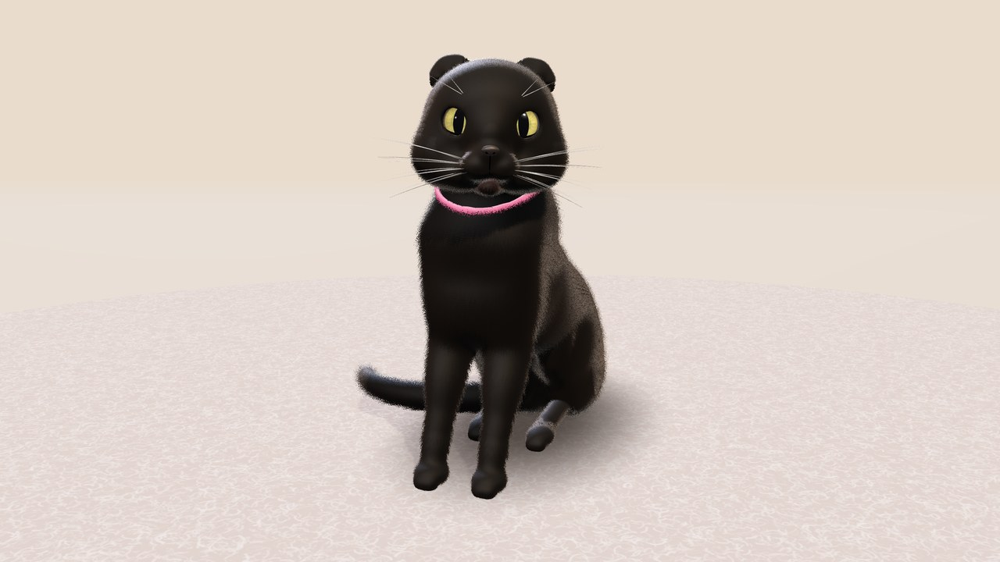

# Black cat

An interactive 3D model of black Scottish Fold cat, Chernushka, that runs in the browser.
Everything is built procedurally with [Three.js](https://threejs.org/): no external models, no build step.

**Live demo:** https://victornagibator.github.io/black-cat-model/



## Features

- **Poses:** stand, sit, loaf, sphinx, lie on side, sleep curled up, belly up.
- **Actions:** sniff a sock (with a flehmen face), yawn, meow, blep, wash, stretch.
- **Interactions:** pet her (hold and drag on the head or back, she purrs), boop the nose, rub the belly when she lies belly up, don't touch the tail.
- **Games:** laser pointer (she stalks and pounces) and a toy mouse.
- Follows the cursor with her eyes, blinks, breathes and lives her own life when idle.
- English / Russian UI.

## Run locally

Requires [Node.js](https://nodejs.org/) (no dependencies to install):

```bash
npm start
```

Then open http://localhost:5188. Any other static file server works too.


## Project structure

| File | Contents |
| --- | --- |
| `src/cat.js` | the model: shell fur, body/neck loft, head, eyes, mouth, legs, tail |
| `src/poses.js` | pose library |
| `src/main.js` | scene, behaviour, input, UI |
| `src/i18n.js` | UI strings (English / Russian) |
| `src/audio.js` | synthesized meow, purr, boop and hiss |
| `serve.js` | tiny zero-dependency dev server |
